# 감사 수정 전후 비교

코드 감사에서 찾은 문제를 고치기 전과 고친 뒤의 동작을 같은 절차로 실행해 기록한 문서다. **BEFORE**는 수정 전, **AFTER**는 수정 후 동작이다.

## 확인 환경

| 항목 | 내용 |
|---|---|
| BEFORE | `main`의 `f464a04` |
| AFTER | `fix/audit-fixes`의 `61b93b7` |
| 실행 | 개발 서버를 Aside 브라우저로 구동 |
| 폴더 열기 | OS 폴더 선택 창만 OPFS(브라우저 내부 저장소) 폴더를 돌려주도록 바꿈. 읽기와 저장은 앱 코드를 그대로 사용 |
| 데이터 | 시험용 합성 노트만 사용 |
| 판정 | 디스크에 저장된 내용, 앱이 표시한 문구, 화면 요소 값을 기준으로 함. 스크린샷은 보조 증거 |
| 자동 검사 | `61b93b7`에서 테스트 155개, TypeScript/Biome, 빌드 통과 |

화면 하단의 빌드 표시는 개발 서버를 시작한 시점의 값이라 위 커밋과 다를 수 있다.

## 요약

| 번호 | 문제 | BEFORE | AFTER | 수정 커밋 |
|---|---|---|---|---|
| 1 | 입력을 멈추면 포커스가 탭으로 이동 | 이어 친 `bcde`가 사라짐 | `abcde` 모두 입력됨 | `ba03dd0` |
| 2 | 큰 노트 하나로 폴더 열기 실패 | 폴더가 열리지 않음 | 그 노트만 건너뛰고 열림 | `e583f7d` |
| 3 | 이름 규칙에 맞지 않는 파일이 조용히 사라짐 | 안내 없음 | 건너뛴 파일 수 안내 | `5c40aa6` |
| 4 | 저장할 때 CRLF가 전부 LF로 바뀜 | `\r\n` 4개 → 0개 | 4개 유지 | `a5cd2e1` |
| 5 | 폴더 저장 미지원 브라우저에서 설명 없음 | 안내 없음 | 먼저 안내 | `e221bb4` |
| 6 | 입력할 때마다 이미지를 다시 읽음 | 5글자 입력 중 5회 추가 | 입력 중 0회 | `9995743` |

## 1부. 원래 있던 문제

### 1. 입력을 멈추면 포커스가 탭으로 이동

**문제:** 글자를 입력하다 잠깐 멈추면 포커스가 편집기에서 탭 버튼으로 옮겨 간다. 그래서 이어서 치는 글자가 노트에 들어가지 않고 사라진다.

**원인:** 앱은 입력이 0.22초 멈추면 탐색기, 백링크, 패널을 다시 그린다. 키마다 다시 계산하면 무겁기 때문이다. 이 시간은 포커스 유지 시간이 아니라 다시 그리기를 기다리는 시간이다. 다시 그린 뒤 포커스를 정리하는 코드가 "포커스가 여기 있어도 되는가"와 "포커스를 잃었는가"를 한 조건에 섞어 판단했다. 그 결과 편집기가 포커스를 그대로 가진 정상 상태까지 탭 버튼으로 옮겼다.

**수정:** 포커스를 유지해도 되는지 먼저 판단하고, 실제로 잃었을 때만 되돌린다.

아래 화면의 빨간 테두리는 포커스 위치를 보여 주려고 시험할 때만 넣은 표시이고, 앱에는 없다. 사진은 입력 0.3초 뒤부터 찍었다.

| BEFORE | AFTER |
|---|---|
| 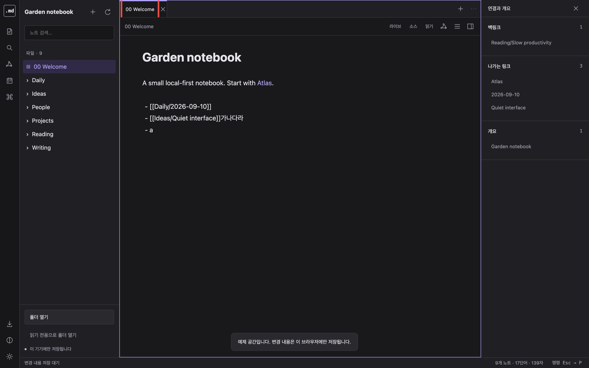 | 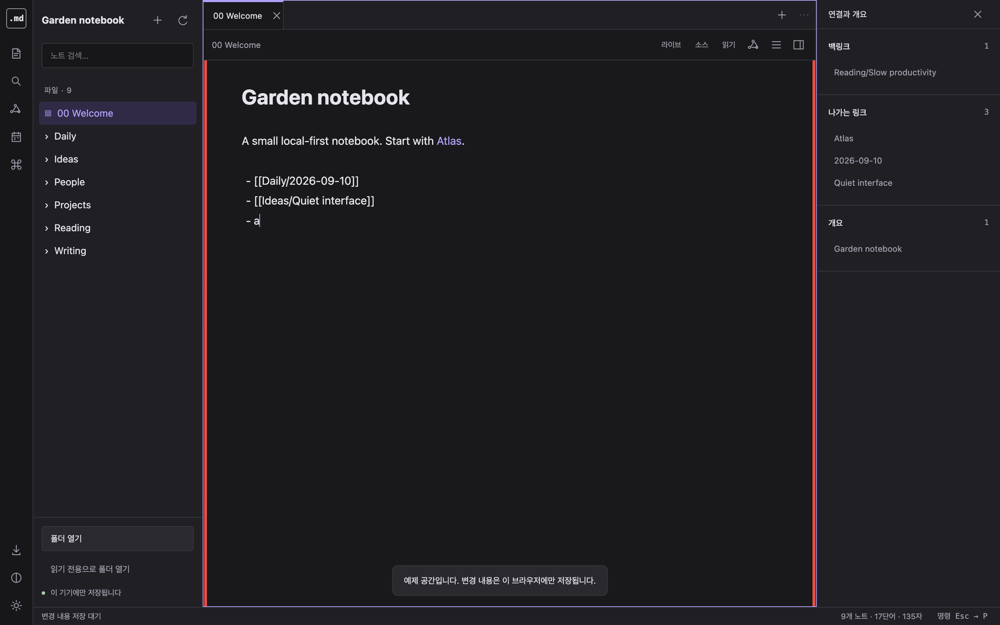 |
| `a` 입력 0.3초 뒤: 포커스가 이미 탭으로 이동 | `a` 입력 0.3초 뒤: 포커스가 편집기에 유지 |
| 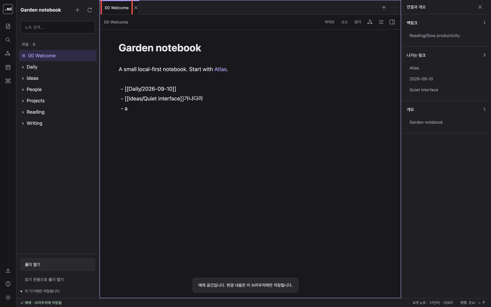 |  |
| 0.7초 더 멈춤: 포커스가 탭에 머묾 | 0.7초 더 멈춤: 포커스가 편집기에 유지 |
|  | 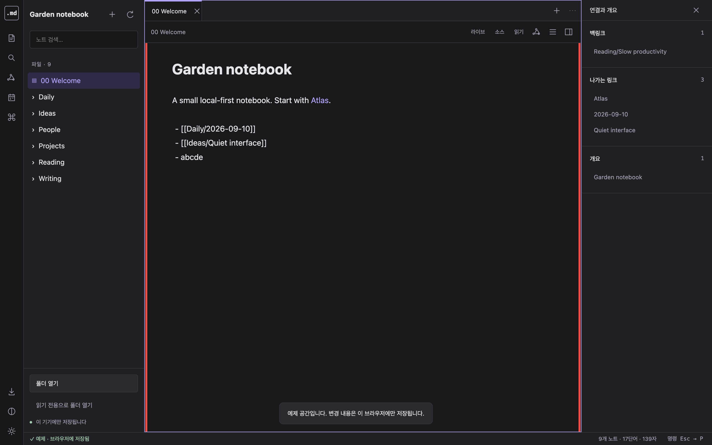 |
| `b c d e` 입력: 노트에 `- a`만 남음 | `b c d e` 입력: `- abcde` 모두 입력됨 |

BEFORE 화면의 `가나다라`는 앞선 시험에서 남은 글자다.

### 2. 큰 노트 하나로 폴더 열기 실패

**문제:** 앱은 노트를 어디에도 업로드하지 않는다. 10MiB는 앱이 열어서 편집할 수 있는 노트 한 개의 최대 크기다. 수정 전에는 이 크기를 넘는 노트가 하나만 있어도 폴더 열기 전체가 실패해서, 나머지 노트까지 쓸 수 없었다.

**수정:** 읽을 수 없는 노트만 건너뛰고 폴더를 연 뒤, 건너뛴 개수를 알린다.

시험 폴더에는 `[[export]]` 링크가 있는 `ok.md`와 11MiB `export.md`를 넣었다.

| BEFORE | AFTER |
|---|---|
| 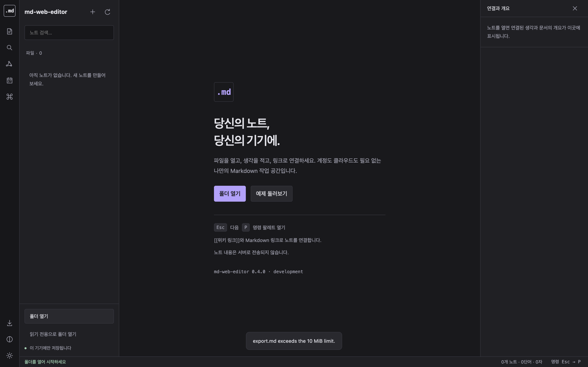 | 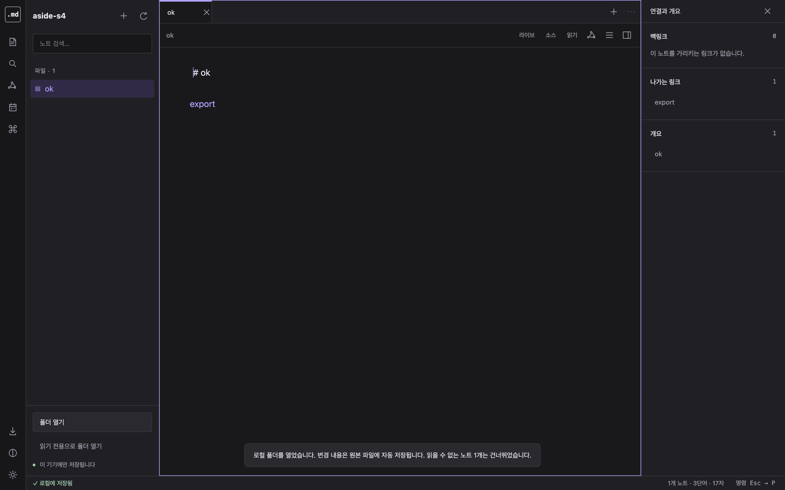 |
| 시작 화면에 머묾. 알림: `export.md exceeds the 10 MiB limit.` | 폴더가 열림. 알림: "읽을 수 없는 노트 1개는 건너뛰었습니다." |

**남은 한계:** 알림에 건너뛴 파일 이름이 없다. 그래프에서는 `export.md`가 "없는 노트(missing)"로 보인다. 다른 곳에서 링크가 가리키는 파일 자체는 있지만 내용을 읽지 못했기 때문이다.

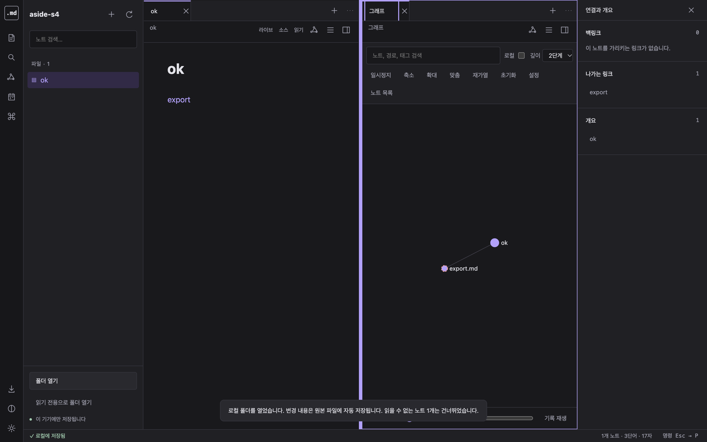

### 3. 이름 규칙에 맞지 않는 파일이 조용히 사라짐

**문제:** 앱은 Windows에서 쓸 수 없는 문자(`? : *` 등)가 들어간 이름을 건너뛴다. macOS와 Linux에서는 `왜?.md`가 정상 파일 이름이라, 사용자는 노트가 왜 보이지 않는지 알 수 없었다.

**수정:** 건너뛰는 규칙은 유지하고, 건너뛴 파일 수를 폴더 열기 알림에 표시한다. `.DS_Store`나 `.obsidian`처럼 원래 숨기는 파일은 세지 않는다.

| BEFORE | AFTER |
|---|---|
| 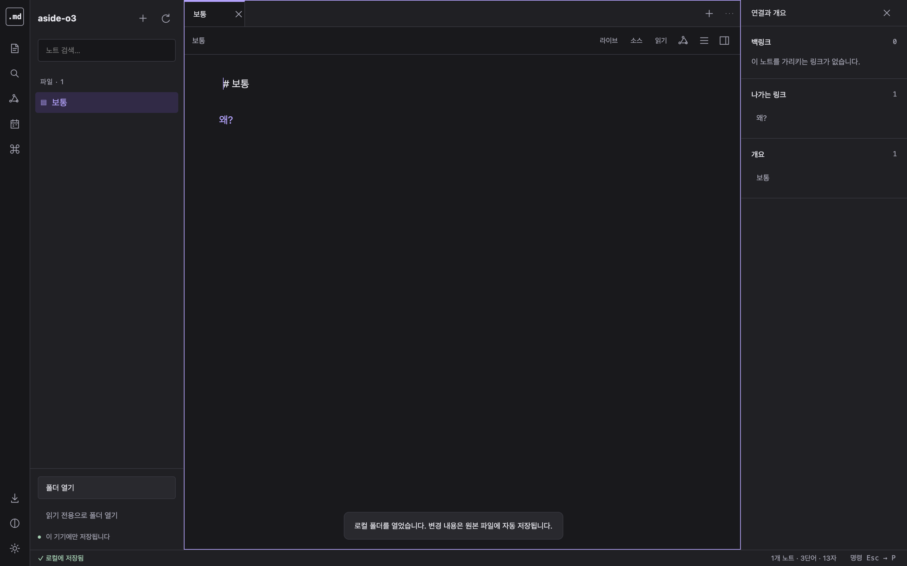 | 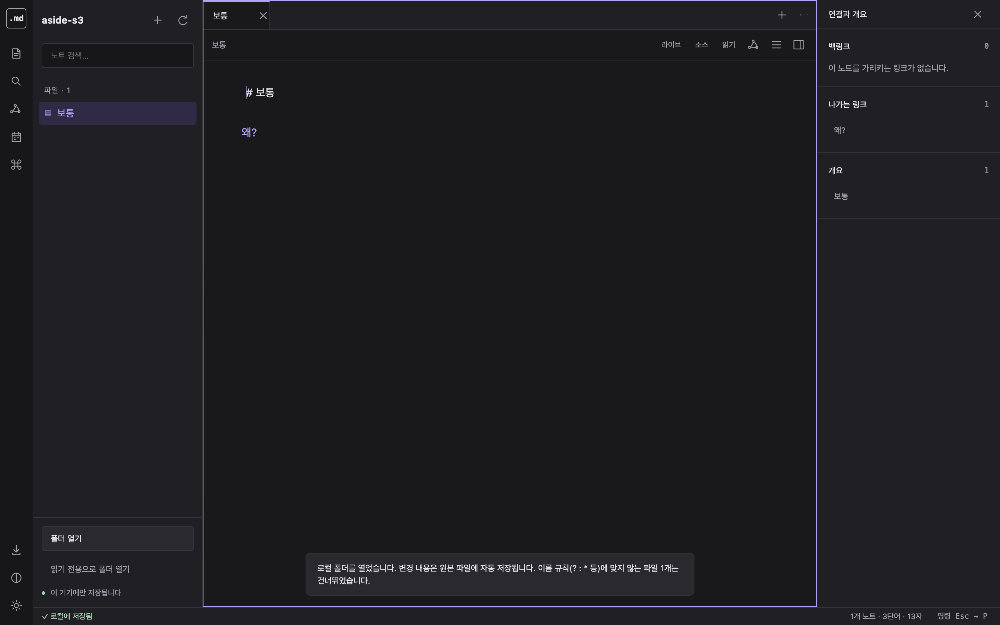 |
| "파일 · 1", 숨긴 파일 안내 없음 | "파일 · 1", 알림: "이름 규칙(? : * 등)에 맞지 않는 파일 1개는 건너뛰었습니다." |

### 4. 저장할 때 CRLF가 전부 LF로 바뀜

**문제:** Windows는 줄바꿈을 두 글자(`\r\n`, CRLF)로, macOS와 Linux는 한 글자(`\n`, LF)로 쓴다. 편집기가 항상 LF로 저장해서, 한 글자만 고쳐도 파일의 모든 줄바꿈이 바뀌었다.

요즘 도구는 대부분 두 형식을 모두 읽는다. 그래서 핵심은 어느 쪽이 더 호환되는가가 아니라, 사용자가 고치지 않은 부분을 편집기가 몰래 바꾸는가이다. 제품 계약에도 원문을 그대로 유지한다고 정해져 있다.

| 측면 | LF로 바뀌면 달라지는 것 |
|---|---|
| 화면 | 없음 |
| 파일 내용 | 줄마다 `\r` 한 글자가 사라짐 |
| git | 설정에 따라 모든 줄이 바뀐 것으로 보임 |
| 오래된 프로그램 | 일부는 LF만 있는 줄바꿈을 인식하지 못함 |
| 동기화 도구 | 파일 전체가 바뀐 것으로 인식 |

**수정:** 열 때의 줄바꿈 형식을 기억했다가 저장할 때 되돌린다. 같은 노트를 여러 창에서 열면 편집기 내부 위치와 CRLF 문자열의 위치가 어긋날 수 있어서, 창끼리 동기화할 때는 비교 전에 줄바꿈을 맞춘다.

화면에는 차이가 보이지 않으므로 저장된 내용으로 판정했다. AFTER는 더 어려운 조건인 여러 창 편집으로 시험했다.

| BEFORE | AFTER |
|---|---|
| 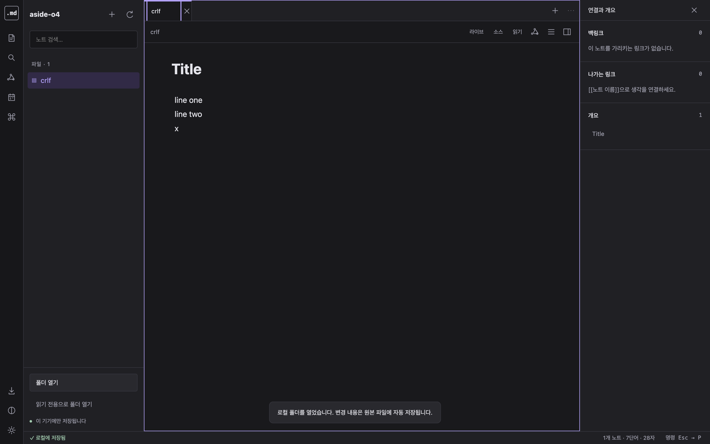 | 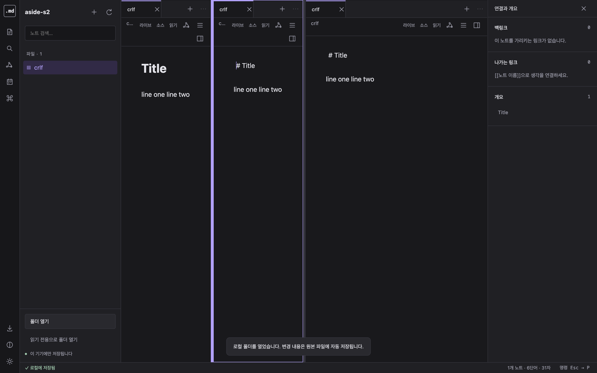 |
| 끝에 `x` 입력 후 저장 | 같은 노트를 여러 창에 열기 |
| | 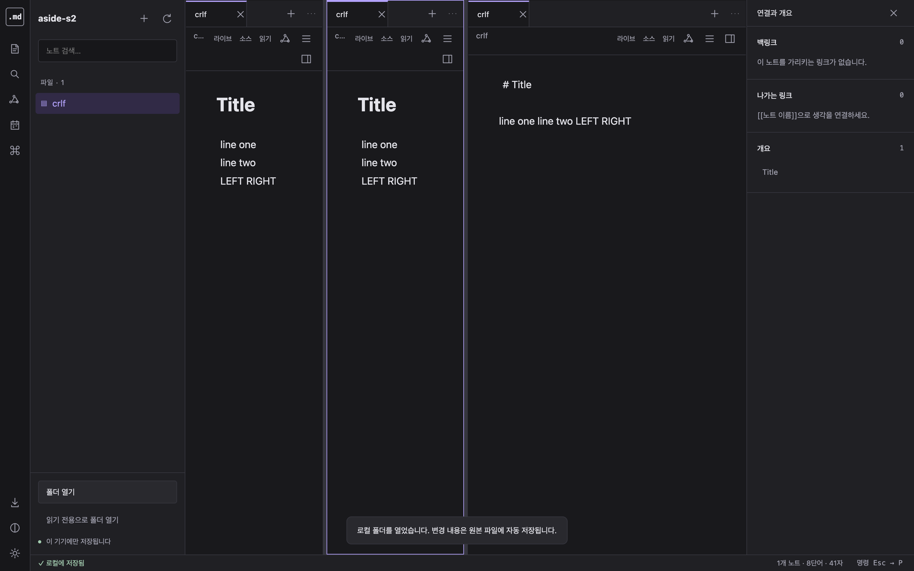 |
| | 한 창에 `LEFT `, 다른 창에 `RIGHT` 입력 |

```text
BEFORE 저장 전: # Title\r\n\r\nline one\r\nline two\r\n
BEFORE 저장 후: # Title\n\nline one\nline two\nx                (\r\n 4개 → 0개)
AFTER  저장 후: # Title\r\n\r\nline one\r\nline two\r\nLEFT RIGHT  (\r\n 4개 유지)
```

창이 3개인 이유는 앞선 시험에서 저장된 패널 배치가 복원됐기 때문으로 추정한다. 한 창에서 문단이 한 줄로 보이는 것은 Markdown의 정상 표시다. 커서가 있는 문단은 원문 줄 그대로 보인다.

### 5. 폴더 저장 미지원 브라우저에서 설명 없음

**문제:** Safari와 Firefox에는 폴더에 직접 저장하는 API가 없어서, "폴더 열기"를 누르면 읽기 전용 선택 창으로 넘어간다. 이 대체 동작은 제품 계약대로지만, 설명이 없어서 왜 편집이 안 되는지 알 수 없었다.

**수정:** 선택 창을 열기 직전에 안내를 표시한다. 기다리는 창이 아니라 알림이므로 같은 클릭 안에서 선택 창이 정상적으로 열린다.

시험에서는 `showDirectoryPicker`를 지워 미지원 브라우저를 흉내 냈다. 실제 OS 선택 창은 가로채고, 열리려 했는지만 기록했다.

| BEFORE | AFTER |
|---|---|
| 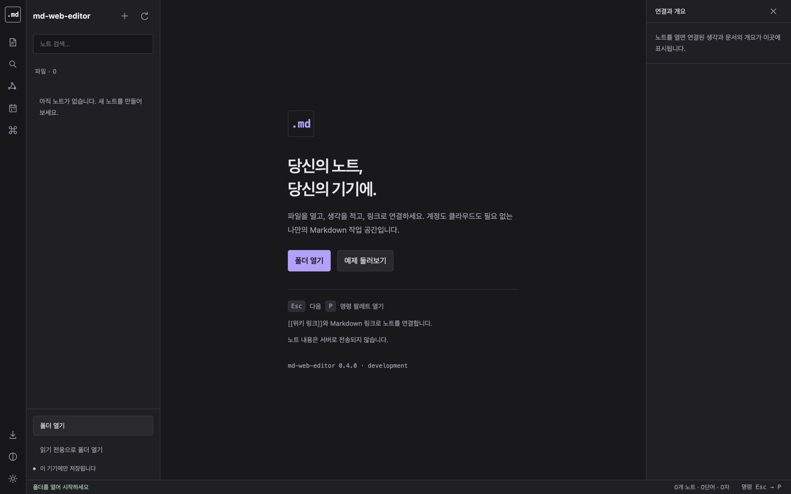 | 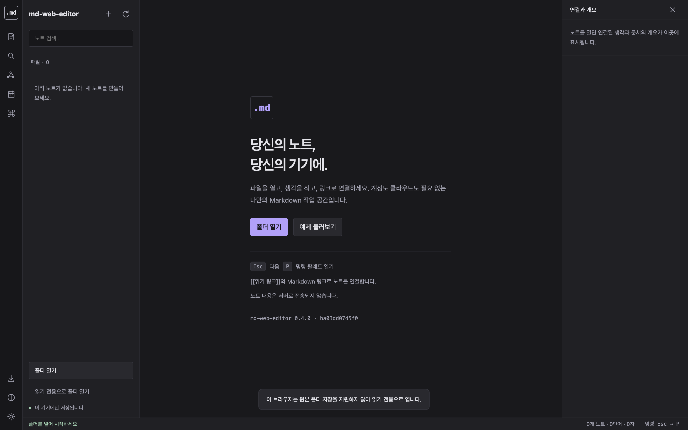 |
| 안내 없음 | 알림: "이 브라우저는 원본 폴더 저장을 지원하지 않아 읽기 전용으로 엽니다." |

### 6. 입력할 때마다 이미지를 다시 읽음

**문제:** 이미지가 있는 노트의 다른 곳에서 글자를 쳐도, 키 하나마다 이미지 파일을 디스크에서 다시 읽었다. 불필요한 작업이고, 이미지가 깜빡이는 원인이 될 수 있다.

**원인:** 라이브 프리뷰는 키를 누를 때마다 블록별 위젯 객체를 새로 만든다. 이것 자체는 가볍다. 비싼 일은 화면의 요소를 지우고 다시 그리는 것이다. CodeMirror는 새 위젯과 기존 위젯을 `eq()`로 비교해서 같으면 화면을 그대로 둔다. 그런데 비교 대상에 문서가 바뀔 때마다 새로 만들어지는 `context` 객체가 있었고, 이것을 참조로 비교해서 결과가 항상 "다름"이었다.

```ts
// 수정 전: 키마다 새로 만들어지는 객체를 참조로 비교하므로 항상 다름
other.context === this.context

// 수정 후: 블록 글자와, 렌더링에 영향을 주는 참조 링크·각주 이름을 값으로 비교
other.content === this.content && other.context.key === this.context.key
```

**수정:** 렌더링 결과를 바꾸는 값으로만 비교한다. 화면을 재사용하면 위젯이 기억하던 문서 위치가 낡을 수 있으므로, 위치는 클릭하는 순간에 `view.posAtDOM()`으로 계산한다. 블록 글자, 참조 링크나 각주 이름이 바뀌거나 모드를 바꾸거나 노트를 다시 열면 이미지는 다시 읽는다.

화면에는 차이가 보이지 않으므로 `pic.png`를 연 횟수로 판정했다. 이 횟수에는 이미지 표시와 무관한 폴더 스캔도 들어 있다.

| 시점 | BEFORE | AFTER |
|---|---|---|
| 폴더 열기: 목록을 만들려고 수정 시각을 읽음 | 1 | 1 |
| 마지막 줄 클릭: 이미지 블록을 처음 표시 | 2 | 2 |
| 5글자 입력 후 | **7** (+5) | **2** (+0) |

총횟수 1 → 7, 1 → 2는 측정값이다. 앞의 두 줄로 나눈 것은 코드 경로를 근거로 한 해석이다.

| BEFORE | AFTER |
|---|---|
|  | 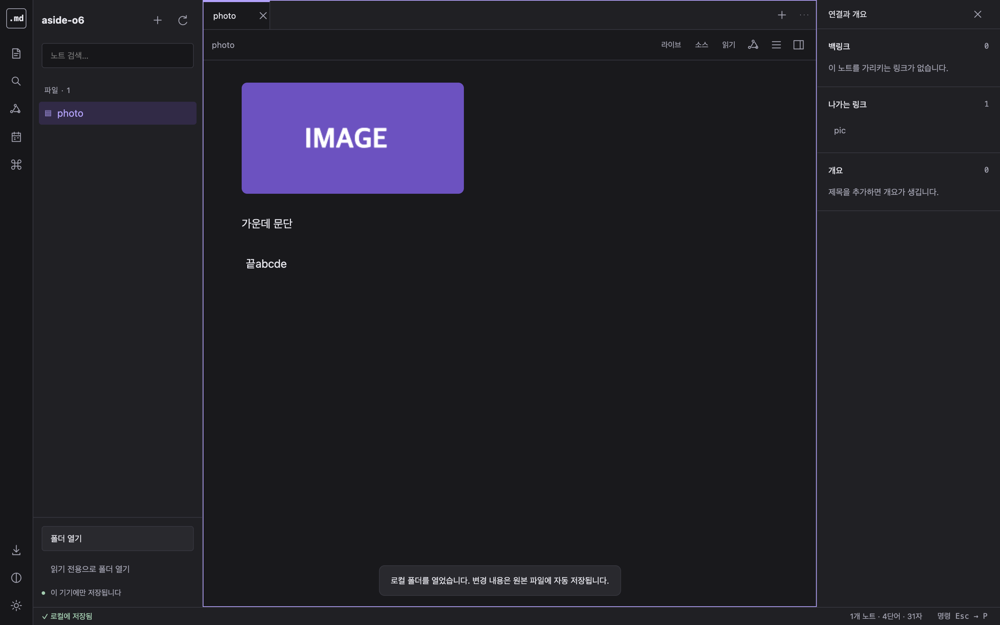 |
| 읽기 1회 → 7회 | 읽기 1회 → 2회 |

## 2부. 수정으로 생길 수 있던 문제 점검

수정 후 코드에서만 확인했다.

### 7. 체크박스가 엉뚱한 줄을 바꾸지 않는가

화면을 재사용하면서 낡은 위치를 쓰면, 체크 표시가 다른 글자 자리에 들어가 노트가 손상될 수 있다. 위 문단에 글을 써서 체크리스트의 실제 위치를 6글자 민 뒤 B를 눌렀다.

| 단계 1 | 단계 2 |
|---|---|
| 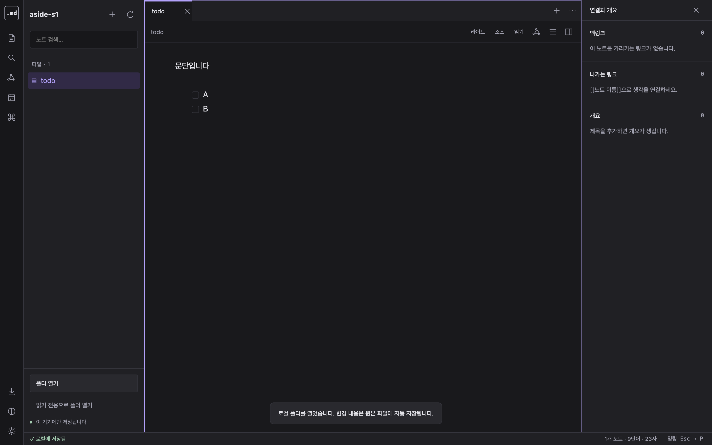 | 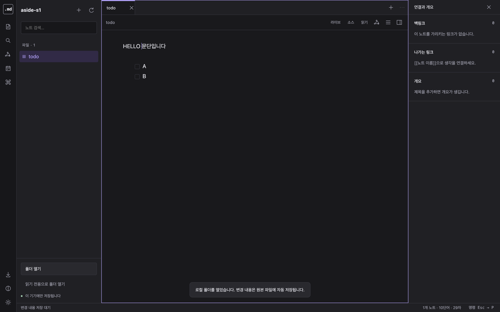 |
| 문단과 체크리스트 A, B | 위 문단 앞에 `HELLO ` 입력 |
| 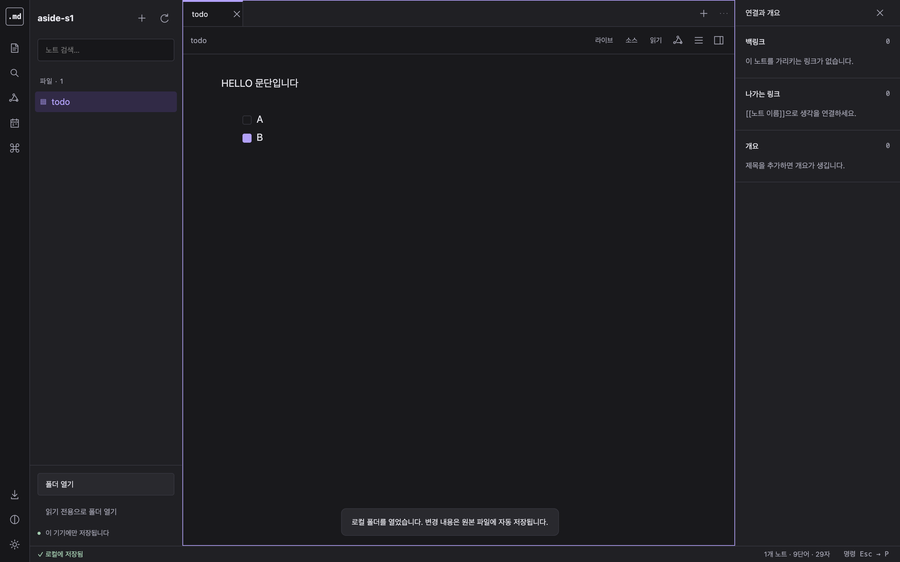 | 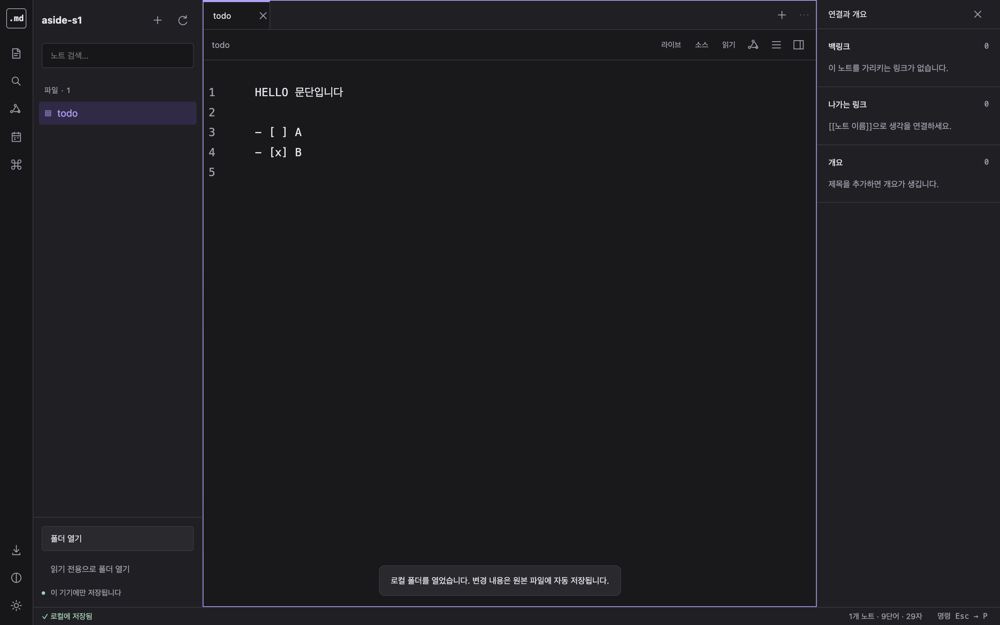 |
| 체크박스 B 클릭 | 소스 모드에서 B 줄만 `[x]` |

```text
디스크 저장 내용: HELLO 문단입니다\n\n- [ ] A\n- [x] B\n
```

**결과:** 문제 없음.

### 8. 폴더에 새로 넣은 이미지가 보이는가

화면을 재사용하면 나중에 추가한 이미지가 해당 블록을 고치기 전까지 안 보일 수 있다고 예상했다.

| 단계 1 | 단계 2 |
|---|---|
| 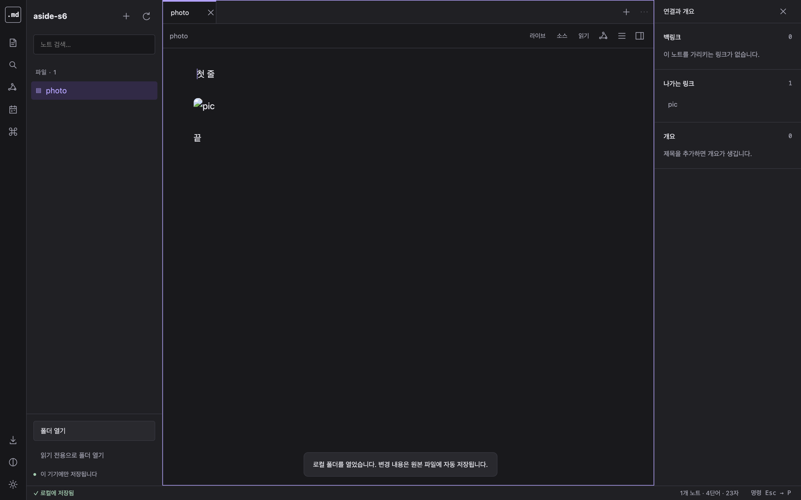 | 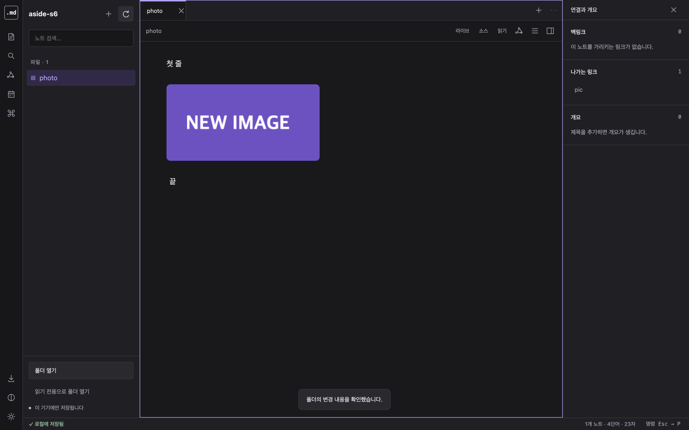 |
| 이미지 파일이 없는 상태 | 이미지 추가 후 "폴더 새로고침": 표시됨 |

**결과:** 문제 없음. 폴더 새로고침이 노트를 다시 불러오면서 블록을 새로 그린다.

## 확인하지 못한 것

| 항목 | 상태 |
|---|---|
| 노트가 많을 때 입력 후 멈춤 (`1259248`) | 수정 전 측정만 있음. 헤드리스 Chrome에서 노트 100개 36ms, 1,000개 2,250ms. 이 비교에서 수정 후는 측정하지 않음 |
| 큰 노트 입력 지연 (`e87ed63`) | 수정 전 측정만 있음. 헤드리스 Chrome에서 1MB 노트 키당 794~901ms. 이 비교에서 수정 후는 측정하지 않음 |
| 줄바꿈이 섞인 파일, CRLF 노트의 글자 수 표시 | 시험하지 않음 |
| 실제 디스크 폴더 | 확인하지 않음. OPFS 폴더로 대체 |
| 실제 Safari, Firefox | 확인하지 않음. API를 지워서 흉내 냄 |
